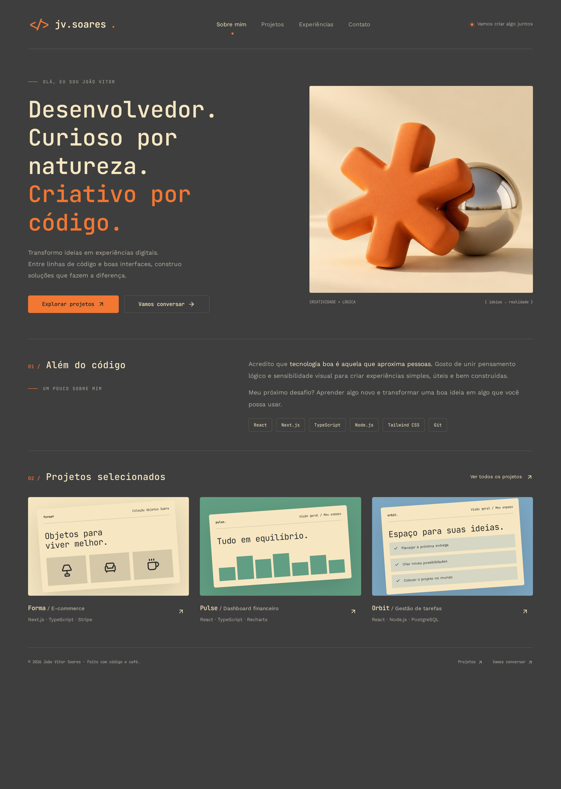
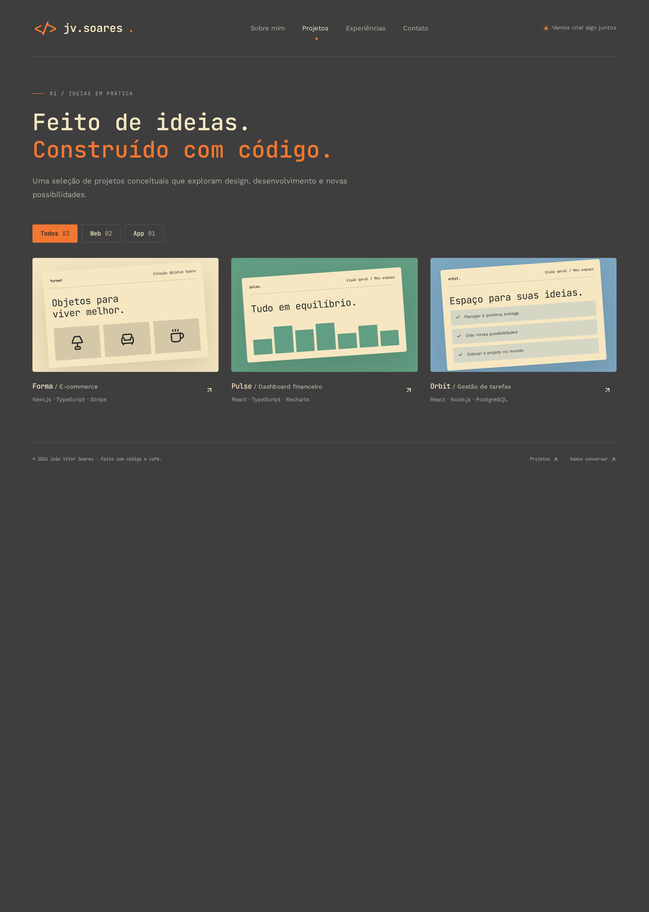
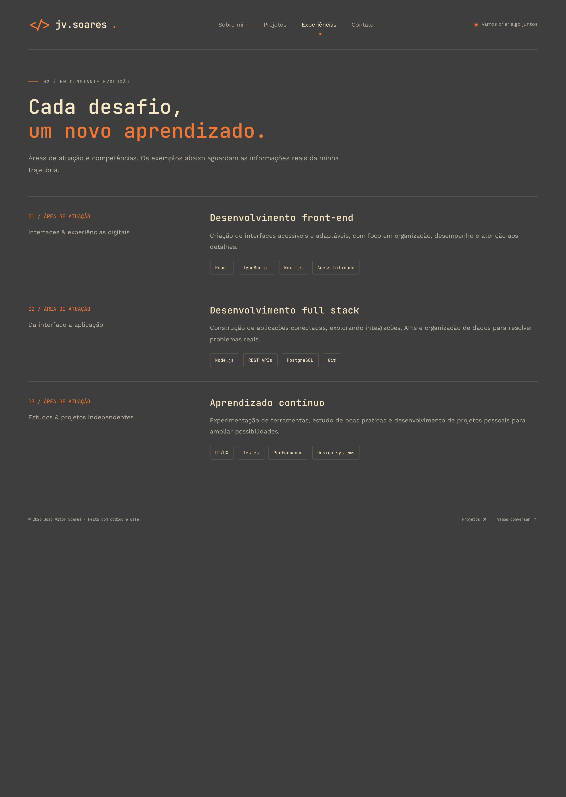
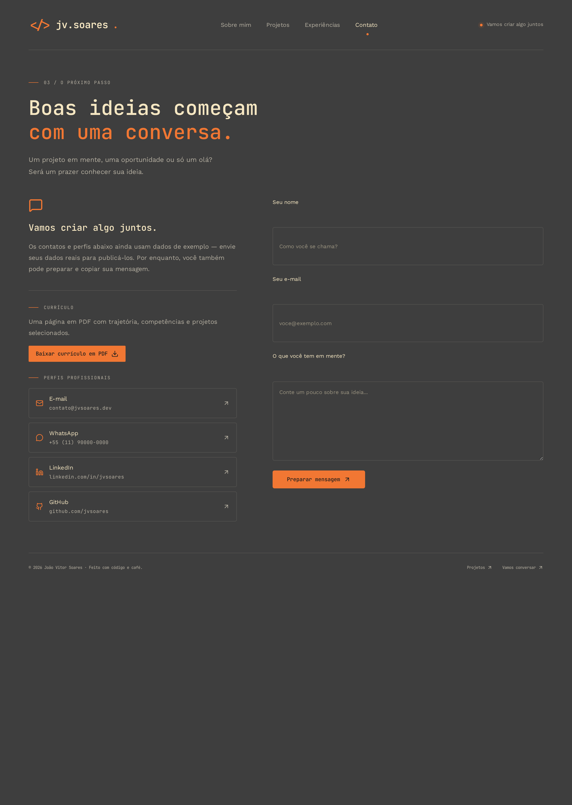

# 🏷️ Nome do Projeto 👨‍💻

<table>
  <tr>
    <td width="800px">
      <div>
        Portfólio pessoal desenvolvido para apresentar meus projetos, habilidades técnicas e experiências, facilitando o acesso ao meu trabalho e destacando minha evolução como desenvolvedor de software.
      </div>
    </td>
    <td>
      <div>
        
      </div>
    </td>
  </tr> 
</table>

---

## 🛠 Tecnologias Utilizadas

As seguintes ferramentas, frameworks e bibliotecas foram utilizados na construção deste projeto. Recomenda-se o uso das versões listadas (ou superiores) para garantir a compatibilidade.

### 💻 Front-end

* **Framework/Biblioteca:** React v19
* **Linguagem/Superset:** TypeScript
* **Estilização:** Tailwind CSS
* **Build Tool:** Vite

---

## 📂 Estrutura de Pastas

Descreva o propósito das pastas principais.

```
.
├── .editorconfig                # ✍️ Padronização de estilo de código.
├── .env.local                   # 🔒 Variáveis SENSÍVEIS do ambiente LOCAL (não versionado).
├── .env.test                    # 🧪 Variáveis de ambiente para TESTES AUTOMATIZADOS.
├── .env.staging                 # ☁️ Variáveis de ambiente para STAGING/HOMOLOGAÇÃO.
├── .env.example                 # 🧩 Exemplo de TODAS as variáveis necessárias (sem valores sensíveis).
├── .gitignore                   # 🧹 Ignora arquivos/pastas não versionadas (.env, node_modules, target, etc.).
├── .vscode/                     # ⚙️ Configurações de ambiente da IDE (opcional).
├── .github/                     # 🤖 CI/CD (Actions), templates de Issues e Pull Requests.
├── README.md                    # 📘 Documentação principal do projeto.
├── CONTRIBUTING.md              # 🤝 Guia de contribuição.
├── LICENSE                      # ⚖️ Licença do projeto.
│
├── /frontend                    # 📁 Aplicação React
│   ├── .eslintrc.js             # ✨ Regras do ESLint.
│   ├── /public                  # 📂 Arquivos estáticos e index.html.
│   ├── /src                     # 📂 Código-fonte React
│   │   ├── /components          # 🧱 Componentes reutilizáveis (UI).
│   │   ├── /view               # 📄 Páginas/rotas da aplicação.
│   │   ├── /styles              # 🎨 Estilos globais, temas, Design System.
│   │   ├── /assets              # 🖼️ Recursos estáticos importados
│   ├── package.json             # 📦 Dependências e scripts.
│
├── /backend                     # 📁 Aplicação Spring Boot
│   │
│   ├── /src/main/java           # 📂 Código-fonte Java
│   │   └── /com/exemplo/app
│   │       ├── /controller      # 🎮 Endpoints REST.
│   │       ├── /service         # ⚙️ Regras e lógica de negócio.
│   │       ├── /repository      # 🗄️ Repositórios (JPA/Hibernate).
│   │       ├── /model           # 🧬 Entidades persistentes (JPA).
│   │       ├── /domain          # 🌐 Objetos de Domínio puro (sem anotações).
│   │       ├── /dto             # ✉️ Data Transfer Objects.
│   │       ├── /config          # 🔧 Configurações gerais (DB, Swagger, CORS, etc.).
│   │       ├── /exception       # 💥 Exceptions e handlers globais.
│   │       └── /security        # 🛡️ Autenticação e Autorização (Spring Security).
│   │
│   ├── /src/main/resources      # 📂 Recursos do Spring Boot
│   │   ├── application.yml         # ⚙️ Configuração principal da aplicação
│   │   ├── application-dev.yml     # 🧪 Configurações específicas do ambiente de DESENVOLVIMENTO
│   │   ├── application-prod.yml    # 🚀 Configurações específicas para PRODUÇÃO
│   │   ├── application-test.yml    # 🧪 Configurações usadas nos testes automatizados
│   │   ├── /static                # 🌐 Arquivos estáticos (HTML/CSS/JS).
│   │   ├── /templates             # 🖼️ Templates Thymeleaf/Freemarker.
│   │   ├── /messages              # 🌎 Arquivos de internacionalização (i18n).
│   │   └── /db                    # 💾 Scripts de banco usados pela aplicação
│   │       └── /migration         # 📜 Migrações do banco (Flyway/Liquibase).
│   │
│   ├── /src/test/java            # 🧪 Testes unitários e de integração.
│   └── pom.xml / build.gradle    # 🛠️ Build e dependências.
│
├── /scripts                      # 📜 Scripts de automação
│   ├── dev.sh                    # 🚀 Ambiente de desenvolvimento completo.
│   ├── build_all.sh              # 🛠️ Build geral (front + back).
│   └── deploy.sh                 # ☁️ Deploy em produção/homologação.
│
├── /docs                         # 📚 Documentação, arquitetura, modelos C4, Swagger/OpenAPI.
└── /tests                        # 🧪 Testes End-to-End (Cypress/Playwright).
```

---

## 🎥 Demonstração

### 🌐 Aplicação Web

<table>
  <tr>
    <h3>Telas</h3>
  </tr>
  <tr>
    <td>Página Inicial (Sobre mim)</td>
    <td>Página de Projetos</td>
    <td>Página de Experiências</td>
    <td>Página de Contato</td>
  </tr>
  <tr>
    <td>
      <div>
        
      </div>
    </td>
    <td>
      <div>
        
      </div>
    </td>
    <td>
      <div>
        
      </div>
    </td>
    <td>
      <div>
        
      </div>
    </td>
  </tr> 
</table>

---

## ✨ Funcionalidades Principais
Liste as funcionalidades de forma clara e objetiva.

- 🌐 **Internacionalização (i18n):** Suporte a múltiplos idiomas.
- 🔄 **Integração com APIs Externas:** Conexão com serviços de terceiros (GitHub).
- 📨 **Sistema de Notificações:** Envio de e-mail.

---

## 🚀 Deploy
Link: https://joaovitorsoares.vercel.app/

---

## 👥 Autores

| 👤 Nome | :octocat: GitHub | 💼 LinkedIn | 📤 Gmail |
|---------|-----------------|-------------|-----------|
| João Vitor Soares  |  <div align="center"><a href="https://github.com/jo-vitor"></a></div> | <div align="center"><a href="https://www.linkedin.com/in/joao-vitor-soares"></a></div> | <div align="center"><a href="mailto:soaresjvs14@gmail.com"></a></div> |